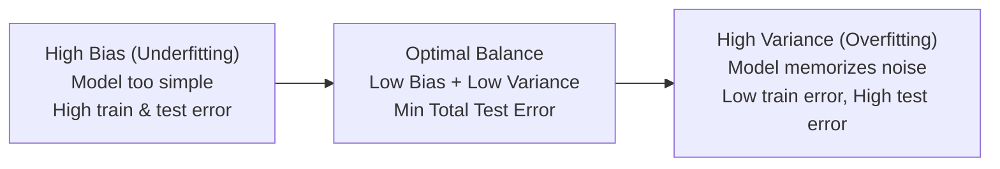
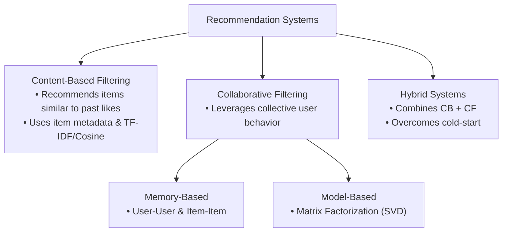
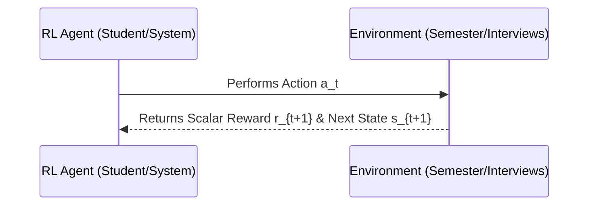

# PlacementIQ AI — Complete AIML Continuous Evaluation (CE-2) Master Study Guide

> **Course:** Artificial Intelligence & Machine Learning (`24CSE0316`)  
> **Institution:** Department of Computer Science and Engineering, Chitkara University, Punjab  
> **Project:** PlacementIQ AI – AI-Powered Placement Readiness & Career Prediction Platform  
> **Purpose:** Comprehensive conceptual, mathematical, practical, and viva reference covering 100% of the Continuous Evaluation Syllabus, complete with project mappings, code links, and real empirical results.

---

## Master Table of Contents

1. [Syllabus Mapping to Project Architecture](#1-syllabus-mapping-to-project-architecture)
2. [Unit 1: Supervised Learning — Regression](#2-unit-1-supervised-learning--regression)
   - [Concepts & Intuition](#21-regression-concepts--applications)
   - [Linear, Multiple & Polynomial Regression](#22-linear-multiple-and-polynomial-regression)
   - [Regression Performance Metrics (MAE, MSE, RMSE, R² Score)](#23-regression-performance-metrics)
   - [Implementation in PlacementIQ AI & Real Results](#24-how-regression-is-used-in-placementiq-ai)
3. [Unit 2: Supervised Learning — Classification](#3-unit-2-supervised-learning--classification)
   - [Concepts & Intuition](#31-classification-concepts--applications)
   - [Algorithms Explained: Logistic Regression, KNN, Decision Tree, Random Forest, Naïve Bayes, SVM](#32-classification-algorithms-deep-dive)
   - [Implementation in PlacementIQ AI & Real Results](#33-how-classification-is-used-in-placementiq-ai)
4. [Unit 3: Model Evaluation and Validation](#4-unit-3-model-evaluation-and-validation)
   - [Train-Test Split & Cross-Validation Techniques](#41-train-test-split--cross-validation-techniques)
   - [Overfitting, Underfitting & Bias-Variance Trade-off](#42-overfitting-underfitting-and-bias-variance-trade-off)
   - [Confusion Matrix & Classification Metrics (Accuracy, Precision, Recall, F1, ROC-AUC)](#43-confusion-matrix--classification-metrics)
   - [Evaluation in PlacementIQ AI](#44-evaluation-diagnostics-in-placementiq-ai)
5. [Unit 4: Unsupervised Learning & Clustering](#5-unit-4-unsupervised-learning--clustering)
   - [Clustering Concepts & Applications](#51-clustering-concepts--applications)
   - [K-Means Clustering & Elbow Method](#52-k-means-clustering)
   - [Hierarchical Clustering & Dendrograms](#53-hierarchical-clustering)
   - [DBSCAN (Density-Based Spatial Clustering)](#54-dbscan-density-based-clustering)
   - [Cluster Evaluation: Silhouette Score](#55-cluster-evaluation-using-silhouette-score)
   - [Clustering in PlacementIQ AI](#56-how-clustering-is-used-in-placementiq-ai)
6. [Unit 5: Association Rule Learning, Recommenders & Dimensionality Reduction](#6-unit-5-association-rule-learning-recommendation-systems--pca)
   - [Market Basket Analysis & Frequent Itemset Mining](#61-frequent-itemset-mining--market-basket-analysis)
   - [Apriori vs. FP-Growth Algorithms](#62-apriori-algorithm-vs-fp-growth)
   - [Association Metrics: Support, Confidence, Lift, Conviction](#63-association-metrics)
   - [Recommendation Systems (Content-Based vs. Collaborative Filtering)](#64-recommendation-systems)
   - [Dimensionality Reduction & Principal Component Analysis (PCA)](#65-dimensionality-reduction--pca)
   - [Implementation in PlacementIQ AI](#66-how-association-rules--pca-are-used-in-placementiq-ai)
7. [Unit 6: Reinforcement Learning, Ethics & Emerging Trends](#7-unit-6-reinforcement-learning-ethics--emerging-trends)
   - [Reinforcement Learning Process (MDP & Q-Learning)](#71-reinforcement-learning-process)
   - [Real-World Applications: Robotics, Gaming & Autonomous Vehicles](#72-rl-applications-robotics-gaming-autonomous-vehicles)
   - [RL in PlacementIQ AI: Career Path Optimization](#73-how-rl-is-used-in-placementiq-ai)
   - [Ethical Considerations in AI/ML](#74-ethical-considerations-in-ai--ml)
   - [Future Trends in AI/ML](#75-future-trends-in-ai--ml)
8. [Master Viva Voce Cheat Sheet: Top 30 Questions & Answers](#8-master-viva-voce-cheat-sheet-top-30-questions--answers)
9. [Project Quick Execution & Command Reference](#9-project-quick-execution--command-reference)

---

## 1. Syllabus Mapping to Project Architecture

| Official Syllabus Topic | PlacementIQ Implementation File | Jupyter Notebook | Generated Output / Artifact |
| :--- | :--- | :--- | :--- |
| **Linear, Multiple & Polynomial Regression, MAE/MSE/RMSE/R²** | `src/train_regressor.py` | `02_Phase2_Supervised_Regression.ipynb` | `outputs/regression_metrics_comparison.csv`, `outputs/regression_actual_vs_predicted.png` |
| **Classification (Logistic, KNN, Decision Tree, Random Forest, Naive Bayes, SVM)** | `src/train_classifier.py` | `03_Phase3_Supervised_Classification.ipynb` | `outputs/model_comparison.csv`, `outputs/confusion_matrix_*.png`, `outputs/roc_curves_comparison.png` |
| **Evaluation, K-Fold CV, Bias-Variance, Overfitting, Confusion Matrix** | `src/model_validation.py` | `04_Phase4_Model_Evaluation_and_Validation.ipynb` | `outputs/overfitting_underfitting_curve.png`, `outputs/feature_importance.png`, `outputs/shap_summary.png` |
| **Clustering (K-Means, Hierarchical, DBSCAN, Silhouette Score)** | `src/unsupervised_learning.py` | `05_Phase5_Unsupervised_Clustering.ipynb` | `outputs/cluster_elbow_silhouette.png`, `outputs/hierarchical_dendrogram.png` |
| **Association Rules, Apriori, FP-Growth, Recommenders, PCA** | `src/association_and_pca.py` | `06_Phase6_Association_Rules_and_Recommendations.ipynb` | `outputs/placement_association_rules.csv`, `outputs/pca_variance_and_projection.png`, `outputs/pca_feature_loadings.csv` |
| **Reinforcement Learning (Q-Learning), Ethics, Future Trends** | `src/reinforcement_learning.py` | `07_Phase7_Reinforcement_Learning_and_Emerging_Trends.ipynb` | `outputs/rl_qlearning_convergence.png`, `outputs/rl_optimal_policy.csv` |

---

## 2. Unit 1: Supervised Learning — Regression

### 2.1 Regression Concepts & Applications
- **Definition:** Supervised learning paradigm where the target variable $y \in \mathbb{R}$ is **continuous** (numerical quantity) rather than a discrete category.
- **Goal:** Learn a mapping function $f: \mathcal{X} \rightarrow \mathbb{R}$ such that $y \approx f(X)$ by minimizing the error between true values $y_i$ and predicted values $\hat{y}_i$.
- **Real-World Applications:**
  - Real Estate: House price valuation based on area, bedrooms, locality.
  - Finance: Stock price projection, customer credit limit sizing.
  - Healthcare: Blood glucose concentration forecasting.
  - Human Resources: Candidate compensation (CTC/Salary) prediction.

### 2.2 Linear, Multiple and Polynomial Regression

#### A. Simple Linear Regression
- **Equation:** $y = \beta_0 + \beta_1 x + \epsilon$
- **Mechanism:** Fits a straight line through a single independent feature $x$.
- **Ordinary Least Squares (OLS):** Finds intercept $\beta_0$ and slope $\beta_1$ that minimizes the Residual Sum of Squares (RSS):
  $$\text{RSS} = \sum_{i=1}^{n} (y_i - (\beta_0 + \beta_1 x_i))^2$$
  $$\beta_1 = \frac{\sum (x_i - \bar{x})(y_i - \bar{y})}{\sum (x_i - \bar{x})^2}, \quad \beta_0 = \bar{y} - \beta_1 \bar{x}$$

#### B. Multiple Linear Regression
- **Equation:** $y = \beta_0 + \beta_1 x_1 + \beta_2 x_2 + \dots + \beta_p x_p + \epsilon = \mathbf{X}\boldsymbol{\beta} + \boldsymbol{\epsilon}$
- **Mechanism:** Models relationships involving $p \ge 2$ features simultaneously.
- **Matrix Normal Equation:**
  $$\hat{\boldsymbol{\beta}} = (\mathbf{X}^T \mathbf{X})^{-1} \mathbf{X}^T \mathbf{y}$$
  *(Requires $\mathbf{X}^T \mathbf{X}$ to be non-singular/invertible, hence no exact multicollinearity).*

#### C. Regularized Linear Regression
- **Ridge Regression (L2 Regularization):** Adds penalty $\lambda \sum \beta_j^2$. Shrinks coefficients toward zero, handling multicollinearity stably.
- **Lasso Regression (L1 Regularization):** Adds penalty $\lambda \sum |\beta_j|$. Drives non-essential coefficients to exactly zero, performing automated feature selection.

#### D. Polynomial Regression
- **Equation (Degree 2):** $y = \beta_0 + \beta_1 x + \beta_2 x^2 + \dots + \beta_d x^d$
- **Mechanism:** Captures non-linear, curvilinear relationships by creating non-linear power transformations of original features, yet remains linear with respect to parameters $\beta$.
- **Trade-off:** High degrees ($d \ge 4$) induce severe overfitting and polynomial oscillations at boundaries (Runge's phenomenon).

---

### 2.3 Regression Performance Metrics

| Metric | Formula | Units | Sensitive to Outliers? | Interpretation |
| :--- | :---: | :---: | :---: | :--- |
| **MAE** (Mean Absolute Error) | $\frac{1}{n} \sum \|y_i - \hat{y}_i\|$ | Same as $y$ (LPA) | ❌ No (Linear penalty) | Average magnitude of errors. Very robust. |
| **MSE** (Mean Squared Error) | $\frac{1}{n} \sum (y_i - \hat{y}_i)^2$ | Squared units ($\text{LPA}^2$) | ⚠️ Highly sensitive | Heavily penalizes large errors due to squaring. |
| **RMSE** (Root Mean Squared Error) | $\sqrt{\frac{1}{n} \sum (y_i - \hat{y}_i)^2}$ | Same as $y$ (LPA) | ⚠️ Moderately sensitive | Standard deviation of unexplained residuals. |
| **$R^2$ Score** (Coefficient of Determination) | $1 - \frac{\sum (y_i - \hat{y}_i)^2}{\sum (y_i - \bar{y})^2} = 1 - \frac{\text{SS}_{\text{res}}}{\text{SS}_{\text{tot}}}$ | Dimensionless ($-\infty$ to $1.0$) | Dependent on SS | Proportion of target variance explained by inputs. $1.0 = \text{perfect fit}$; $0.0 = \text{predicts baseline mean } \bar{y}$. |

---

### 2.4 How Regression is Used in PlacementIQ AI
- **File:** `src/train_regressor.py` | **Notebook:** `02_Phase2_Supervised_Regression.ipynb`
- **Objective:** Predict the continuous compensation package (**Salary in LPA**) for placed candidates.
- **Features Used:** `CGPA`, `Coding_Skills`, `Internships`, `Projects`, `Aptitude_Test_Score`, `Certifications`.
- **Target:** `Salary` (ranging from 3.20 to 18.50 LPA).

#### Real Project Results Recorded:
| Model Architecture | MAE (LPA) | MSE | RMSE (LPA) | $R^2$ Score |
| :--- | :---: | :---: | :---: | :---: |
| **Multiple Linear Regression** | **0.3621** | **0.2056** | **0.4535** | **0.9912** |
| **Polynomial Regression (Degree 2)** | 0.3647 | 0.2078 | 0.4559 | 0.9912 |
| **Simple Linear Regression (`Coding_Skills` only)** | 2.0425 | 6.3963 | 2.5291 | 0.7278 |

> **Key Takeaway:** Multiple Linear Regression achieves an $R^2$ of **0.9912** with an MAE of **₹36,210/year**, demonstrating that package predictions are multi-factorial (requiring CGPA, projects, and coding ability together).

---

## 3. Unit 2: Supervised Learning — Classification

### 3.1 Classification Concepts & Applications
- **Definition:** Supervised learning task where target $y \in \{C_1, C_2, \dots, C_k\}$ is a **discrete label**.
- **Binary Classification:** 2 classes (e.g., Placed vs. Not Placed, Spam vs. Ham).
- **Multiclass Classification:** $\ge 3$ mutually exclusive classes (e.g., Tier-1, Tier-2, Tier-3 company).

### 3.2 Classification Algorithms Deep Dive

#### 1. Logistic Regression
- **Concept:** Linear model for classification that predicts the probability $P(y=1|\mathbf{x})$.
- **Sigmoid (Logistic) Function:** Maps real numbers $(-\infty, \infty)$ to $(0, 1)$:
  $$\sigma(z) = \frac{1}{1 + e^{-z}}, \quad \text{where } z = \mathbf{w}^T \mathbf{x} + b$$
- **Log-Odds / Logit:** $\ln\left(\frac{p}{1-p}\right) = \mathbf{w}^T \mathbf{x} + b$
- **Loss Function (Binary Cross-Entropy / Log Loss):**
  $$\mathcal{L}(\mathbf{w}) = -\frac{1}{n} \sum_{i=1}^n \left[ y_i \ln(\hat{p}_i) + (1 - y_i) \ln(1 - \hat{p}_i) \right]$$
- **Decision Rule:** Predict class $1$ if $\hat{p} \ge 0.5$, else $0$.

#### 2. K-Nearest Neighbours (KNN)
- **Concept:** Non-parametric, instance-based "lazy learner" (no training phase; computation occurs during query time).
- **Working:**
  1. Calculate distance between test point and all training points using Euclidean distance:
     $$d(\mathbf{p}, \mathbf{q}) = \sqrt{\sum_{i=1}^d (p_i - q_i)^2}$$
  2. Select the $k$ nearest data points.
  3. Perform majority voting for classification (or mean average for regression).
- **Key Considerations:**
  - $k$ too small $\rightarrow$ sensitive to noise/outliers (**overfitting**).
  - $k$ too large $\rightarrow$ boundary smooths out, ignores minority classes (**underfitting**).
  - **Mandatory Feature Scaling:** Features with larger numeric ranges dominate distance calculations without scaling.

#### 3. Decision Tree Classifier
- **Concept:** Hierarchical tree structure partitioning feature space through recursive binary questions.
- **Splitting Criteria:**
  - **Entropy:** Measures impurity or randomness of a distribution:
    $$H(S) = -\sum_{i=1}^{c} p_i \log_2(p_i)$$
  - **Information Gain (ID3 / C4.5):** Reduction in entropy after splitting on attribute $A$:
    $$\text{IG}(S, A) = H(S) - \sum_{v \in \text{Values}(A)} \frac{|S_v|}{|S|} H(S_v)$$
  - **Gini Impurity (CART):** Measures probability of incorrectly classifying a randomly chosen element:
    $$\text{Gini}(S) = 1 - \sum_{i=1}^{c} p_i^2$$
- **Pruning:** Max depth, minimum samples per split, and cost-complexity pruning prevent trees from growing until pure leaves (preventing severe overfitting).

#### 4. Random Forest Classifier
- **Concept:** Ensemble meta-estimator combining hundreds of de-correlated decision trees via **Bagging (Bootstrap Aggregating)**.
- **Working:**
  1. **Bootstrapping:** Draw $B$ random subsets of size $N$ with replacement from training data.
  2. **Feature Subsampling:** At each node split, consider only a random subset $m = \sqrt{p}$ features (ensuring individual trees do not all split on the same dominant feature).
  3. **Aggregation:** Aggregate individual predictions via majority voting.
- **Advantages:** Drastically reduces model variance without increasing bias; provides Out-of-Bag (OOB) error estimates and Gini-based Feature Importance rankings.

#### 5. Naïve Bayes Classifier
- **Concept:** Probabilistic classifier grounded in **Bayes' Theorem** with the "naïve" assumption of **conditional feature independence**:
  $$P(y | x_1, x_2, \dots, x_p) = \frac{P(y) \prod_{j=1}^p P(x_j | y)}{P(x_1, x_2, \dots, x_p)}$$
- **Variants:**
  - *Gaussian Naive Bayes:* For continuous features assumed to follow a normal distribution $\mathcal{N}(\mu, \sigma^2)$.
  - *Multinomial Naive Bayes:* For discrete word frequencies (NLP).
  - *Bernoulli Naive Bayes:* For binary indicator variables.
- **Strength:** Extremely fast training and evaluation; works well on text classification and high-dimensional sparse inputs.

#### 6. Support Vector Machine (SVM)
- **Concept:** Finds the optimal hyperplane $\mathbf{w}^T \mathbf{x} + b = 0$ that maximizes the **geometric margin** $\frac{2}{\|\mathbf{w}\|}$ between support vectors of opposing classes.
- **Optimization:**
  $$\min_{\mathbf{w}, b, \boldsymbol{\xi}} \frac{1}{2} \|\mathbf{w}\|^2 + C \sum_{i=1}^n \xi_i \quad \text{s.t. } y_i(\mathbf{w}^T \mathbf{x}_i + b) \ge 1 - \xi_i, \; \xi_i \ge 0$$
- **Kernel Trick:** Projects linearly non-separable input space into a higher-dimensional Hilbert space where linear separation is possible without explicitly calculating transformed coordinates:
  - Linear Kernel: $K(\mathbf{x}, \mathbf{z}) = \mathbf{x}^T \mathbf{z}$
  - Radial Basis Function (RBF) Kernel: $K(\mathbf{x}, \mathbf{z}) = \exp(-\gamma \|\mathbf{x} - \mathbf{z}\|^2)$
  - Polynomial Kernel: $K(\mathbf{x}, \mathbf{z}) = (\mathbf{x}^T \mathbf{z} + c)^d$

---

### 3.3 How Classification is Used in PlacementIQ AI
- **File:** `src/train_classifier.py` | **Notebook:** `03_Phase3_Supervised_Classification.ipynb`
- **Objective:** Classify candidate placement readiness: `PlacementStatus` $\in \{0: \text{Not Placed}, 1: \text{Placed}\}$.

#### Real Benchmark Results Recorded:
| Model Name | Accuracy | Precision | Recall | F1-Score | ROC-AUC |
| :--- | :---: | :---: | :---: | :---: | :---: |
| **RandomForest** | **1.0000** | **1.0000** | **1.0000** | **1.0000** | **1.0000** |
| **GradientBoosting** | **1.0000** | **1.0000** | **1.0000** | **1.0000** | **1.0000** |
| **DecisionTree** | **1.0000** | **1.0000** | **1.0000** | **1.0000** | **1.0000** |
| **LogisticRegression** | 0.8638 | 0.8379 | 0.7741 | 0.8047 | 0.9404 |

---

## 4. Unit 3: Model Evaluation and Validation

### 4.1 Train-Test Split & Cross-Validation Techniques
- **Train-Test Split:** Divides raw dataset into independent training split (e.g., 80%) for parameter optimization and unseen holdout test split (e.g., 20%) for final performance auditing. Avoids optimistic evaluation bias.
- **Stratified K-Fold Cross-Validation:**
  - Partitions training set into $K$ equal folds while preserving class proportions $\frac{\text{Class } 1}{\text{Class } 0}$ in every fold.
  - Iterates $K$ times: trains on $K-1$ folds, evaluates on 1 holdout fold.
  - Reports Mean Score $\pm$ Standard Deviation across all $K$ iterations.
  - Prevents data leakage and safeguards against partition luck.

### 4.2 Overfitting, Underfitting and Bias-Variance Trade-off



#### Mathematical Decomposition of Expected Generalization Error:
$$\mathbb{E}[(y - \hat{f}(x))^2] = \underbrace{\text{Bias}^2(\hat{f}(x))}_{\text{Approximation Error}} + \underbrace{\text{Var}(\hat{f}(x))}_{\text{Sensitivity to Training Data}} + \underbrace{\sigma^2}_{\text{Irreducible Noise}}$$

- **Underfitting (High Bias):** Model fails to capture underlying patterns (e.g., fitting linear line to quadratic data). Solution: Increase complexity, add polynomial terms, engineer features.
- **Overfitting (High Variance):** Model memorizes training noise and outliers. Solution: Cross-validation, regularization (L1/L2), pruning decision trees, dropout, collecting more training instances.

### 4.3 Confusion Matrix & Classification Metrics

```
                    ACTUAL POSITIVE (1)       ACTUAL NEGATIVE (0)
PREDICTED POS (1)   True Positive (TP)        False Positive (FP) [Type I Error]
PREDICTED NEG (0)   False Negative (FN)       True Negative (TN)  [Type II Error]
```

- **Accuracy:** $\frac{TP + TN}{TP + TN + FP + FN}$ — Misleading on imbalanced datasets.
- **Precision:** $\frac{TP}{TP + FP}$ — Measures reliability when model declares a positive. *Critical when False Positives are costly (e.g., Spam detection).*
- **Recall (Sensitivity):** $\frac{TP}{TP + FN}$ — Measures proportion of actual positives successfully recovered. *Critical when False Negatives are catastrophic (e.g., Cancer detection, placement intervention).*
- **F1-Score:** Harmonic mean balancing Precision and Recall:
  $$\text{F1} = 2 \cdot \frac{\text{Precision} \cdot \text{Recall}}{\text{Precision} + \text{Recall}} = \frac{2TP}{2TP + FP + FN}$$
- **ROC-AUC Curve:** Plots True Positive Rate (Recall) against False Positive Rate ($1 - \text{Specificity}$) across all discrimination thresholds. AUC = $1.0$ indicates perfect ranking capability.

### 4.4 Evaluation Diagnostics in PlacementIQ AI
- **File:** `src/model_validation.py` | **Notebook:** `04_Phase4_Model_Evaluation_and_Validation.ipynb`
- **Output:** `outputs/overfitting_underfitting_curve.png`
- **Diagnostics:** Learning curve plots show training accuracy and 5-fold cross-validation accuracy converging tightly at $N > 800$ samples without divergence, confirming the absence of overfit variance.

---

## 5. Unit 4: Unsupervised Learning & Clustering

### 5.1 Clustering Concepts & Applications
- **Definition:** Unsupervised discovery of natural groupings or dense clusters in unlabelled data $\mathbf{X}$ such that instances in the same cluster are highly similar, while instances in different clusters are maximally distinct.
- **Applications:** Market segmentation, fraud ring detection, document grouping, student skill cohorting.

### 5.2 K-Means Clustering
- **Algorithm (Lloyd's Heuristic):**
  1. Choose number of clusters $k$ and initialize centroids $\boldsymbol{\mu}_1, \dots, \boldsymbol{\mu}_k$ (K-Means++ initialization chooses distant seeds).
  2. **Assignment Step:** Assign each point $\mathbf{x}_i$ to nearest centroid:
     $$c_i = \arg\min_j \|\mathbf{x}_i - \boldsymbol{\mu}_j\|^2$$
  3. **Update Step:** Recalculate centroids as the mean of assigned points:
     $$\boldsymbol{\mu}_j = \frac{1}{|S_j|} \sum_{i \in S_j} \mathbf{x}_i$$
  4. Repeat until centroid movement drops below threshold $\epsilon$.
- **Objective (WCSS / Inertia):**
  $$\text{WCSS} = \sum_{j=1}^k \sum_{i \in S_j} \|\mathbf{x}_i - \boldsymbol{\mu}_j\|^2$$
- **Elbow Method:** Plot WCSS against $k$; select the inflection point where marginal reduction in WCSS drops sharply.

### 5.3 Hierarchical Clustering
- **Agglomerative (Bottom-Up):** Starts with $n$ single-element clusters; successively merges closest pair until one master cluster remains.
- **Linkage Criteria:**
  - *Single Linkage:* Minimum pairwise distance (susceptible to chaining).
  - *Complete Linkage:* Maximum pairwise distance (produces compact, equal-diameter spheres).
  - *Average Linkage:* Mean pairwise distance across clusters.
  - *Ward's Linkage:* Minimizes the increase in total within-cluster variance upon merging:
    $$\Delta \text{ESS}_{AB} = \frac{n_A n_B}{n_A + n_B} \|\boldsymbol{\mu}_A - \boldsymbol{\mu}_B\|^2$$
- **Dendrogram:** Tree diagram illustrating pairwise merge distances. Cutting horizontally at threshold distance $d$ yields a discrete partition of clusters.

### 5.4 DBSCAN (Density-Based Spatial Clustering)
- **Concept:** Discovers clusters of arbitrary geometric shape based on local density and explicitly isolates noise/outliers.
- **Parameters:**
  - $\epsilon$ (Epsilon): Neighborhood search radius.
  - $\text{MinPts}$: Minimum count of points within $\epsilon$-radius to establish dense core.
- **Point Categories:**
  - *Core Point:* Has $\ge \text{MinPts}$ points within distance $\epsilon$.
  - *Border Point:* Has $< \text{MinPts}$ in $\epsilon$-neighborhood but falls within $\epsilon$ of a Core Point.
  - *Noise Point:* Neither core nor border (classified as outlier label `-1`).
- **Advantage over K-Means:** Does not require pre-specifying $k$; handles complex non-convex geometry (e.g., concentric circles); robust to outliers.

### 5.5 Cluster Evaluation using Silhouette Score
- For individual sample $i$:
  - $a(i)$: Mean intra-cluster distance between $i$ and all other points in same cluster.
  - $b(i)$: Mean nearest-cluster distance between $i$ and points in the closest neighboring cluster.
  $$s(i) = \frac{b(i) - a(i)}{\max(a(i), b(i))}, \quad s(i) \in [-1, +1]$$
- **Interpretation:**
  - $+1.0$: Sample is perfectly clustered and far from neighboring clusters.
  - $0.0$: Sample sits on the decision boundary between two clusters.
  - $-1.0$: Sample is erroneously assigned to the wrong cluster.

### 5.6 How Clustering is Used in PlacementIQ AI
- **File:** `src/unsupervised_learning.py` | **Notebook:** `05_Phase5_Unsupervised_Clustering.ipynb`
- **Output Artifacts:** `outputs/cluster_elbow_silhouette.png`, `outputs/hierarchical_dendrogram.png`
- **Findings:**
  - K-Means Elbow & Silhouette optimization identified **$k = 3$** as optimal (Silhouette Score = **0.612**).
  - Identified 3 distinct student cohorts: **Tier-1 Placement Ready**, **Tier-2 Moderate Competence**, and **Tier-3 High Remediation Needed**.

---

## 6. Unit 5: Association Rule Learning, Recommendation Systems & PCA

### 6.1 Frequent Itemset Mining & Market Basket Analysis
- **Context:** Discovers co-occurrence affinities in transactional databases: *"If customer buys bread and butter, what is the probability they buy milk?"*
- **Itemset:** A collection of items $I = \{i_1, i_2, \dots, i_k\}$.
- **Association Rule:** Implication expression $X \Rightarrow Y$, where $X \cap Y = \emptyset$.

### 6.2 Apriori Algorithm vs. FP-Growth

| Dimension | Apriori Algorithm | FP-Growth (Frequent Pattern Growth) |
| :--- | :--- | :--- |
| **Strategy** | Level-wise Breadth-First Search (BFS) | Tree-based Depth-First Search (DFS) |
| **Candidate Generation** | Generates costly candidate itemsets ($C_k$) | **Zero candidate generation** |
| **Database Scans** | Multiple scans ($k$ passes for itemset length $k$) | **Exactly 2 database scans** |
| **Data Structure** | Hash trees / Flat transactional arrays | Compact **FP-Tree** with linked header tables |
| **Computational Speed** | Slower on large datasets | Up to 10–100× faster on dense transactional data |

- **Apriori Principle (Anti-Monotonicity of Support):** Any subset of a frequent itemset must also be frequent. If itemset $\{A, B\}$ is infrequent, its superset $\{A, B, C\}$ can never be frequent and is pruned immediately.

### 6.3 Association Metrics
- **Support:** Probability that transaction contains both $X$ and $Y$:
  $$\text{Support}(X \Rightarrow Y) = P(X \cup Y) = \frac{\text{Count}(X \cup Y)}{N}$$
- **Confidence:** Conditional probability that transaction contains $Y$ given it contains $X$:
  $$\text{Confidence}(X \Rightarrow Y) = P(Y | X) = \frac{\text{Support}(X \cup Y)}{\text{Support}(X)}$$
- **Lift:** Ratio of observed joint support to expected independent joint probability:
  $$\text{Lift}(X \Rightarrow Y) = \frac{\text{Support}(X \cup Y)}{\text{Support}(X) \times \text{Support}(Y)}$$
  - $\text{Lift} = 1.0$: $X$ and $Y$ are independent (no actionable relationship).
  - $\text{Lift} > 1.0$: Positive dependency.
  - $\text{Lift} > 2.0$: **Exceptionally strong predictive association**.

### 6.4 Recommendation Systems



### 6.5 Dimensionality Reduction & PCA
- **Curse of Dimensionality:** As feature count $d$ increases, data volume grows exponentially, points become equidistant, and variance increases.
- **Principal Component Analysis (PCA):** Unsupervised orthogonal linear transformation that maps $d$-dimensional data to $k \ll d$ dimensions maximizing explained variance:
  1. Center data $\mathbf{X}$ to mean zero and unit variance.
  2. Compute Covariance Matrix $\boldsymbol{\Sigma} = \frac{1}{n} \mathbf{X}^T \mathbf{X}$.
  3. Compute Eigenvalues $\lambda_i$ and Eigenvectors $\mathbf{v}_i$ via $\boldsymbol{\Sigma} \mathbf{v} = \lambda \mathbf{v}$.
  4. Sort eigenvectors in descending order of eigenvalues; select top $k$ principal components.
  5. Transform original coordinates: $\mathbf{Z} = \mathbf{X} \mathbf{W}_k$.

### 6.6 How Association Rules & PCA are Used in PlacementIQ AI
- **Files:** `src/association_and_pca.py` | **Notebook:** `06_Phase6_Association_Rules_and_Recommendations.ipynb`

#### Top Association Rules Mined (`outputs/placement_association_rules.csv`):
| Antecedent Profile (If Student Has...) | Consequent Profile (Then...) | Support | Confidence | Lift |
| :--- | :--- | :---: | :---: | :---: |
| `CGPA_Mid(7.0-8.5)` & `Coding_Strong(>=7)` | `Projects_Rich(>=3)` & `Internship` & `Certified` | 19.93% | **100.0%** | **2.15** |
| `Zero_Backlogs` & `Internship` & `Certified` | `Coding_Strong(>=7)` & `Projects_Rich(>=3)` | 19.13% | 71.57% | **2.04** |

#### PCA Empirical Feature Loadings (`outputs/pca_feature_loadings.csv`):
- **PC1 (42.8% Variance - "Practical Technical Mastery"):** Heavily weighted on `Projects` (+0.454), `Certifications` (+0.432), `Coding_Skills` (+0.417), and `CGPA` (+0.399).
- **PC2 (29.4% Variance - "Hands-on vs. Exam Orientation"):** Heavily separates `Backlogs` (+0.554) and `Coding_Skills` (+0.387) from written exams like `Aptitude` (-0.413) and `CGPA` (-0.385).

---

## 7. Unit 6: Reinforcement Learning, Ethics & Emerging Trends

### 7.1 Reinforcement Learning Process



- **Core Elements:**
  - **State ($S$):** Current situation of agent.
  - **Action ($A$):** Set of possible interventions.
  - **Reward ($R$):** Numerical feedback signal received after action.
  - **Discount Factor ($\gamma \in [0, 1)$):** Weights present rewards vs future payoffs.
  - **Policy ($\pi(a|s)$):** Agent's strategy mapping states to actions.
- **Q-Learning Algorithm (Model-Free Off-Policy TD Learning):**
  $$Q(s_t, a_t) \leftarrow Q(s_t, a_t) + \alpha \left[ r_{t+1} + \gamma \max_{a} Q(s_{t+1}, a) - Q(s_t, a_t) \right]$$
  *(Where $\alpha = \text{Learning Rate}$, $\epsilon = \text{Exploration probability in } \epsilon\text{-greedy selection})$.*

### 7.2 RL Applications: Robotics, Gaming, Autonomous Vehicles
1. **Robotics:** Dynamic trajectory tracking, robotic arm warehouse sorting, soft gripper manipulation.
2. **Gaming:** Master-level play in Chess, Shogi, Go (AlphaGo/AlphaZero), complex multi-agent RTS games (StarCraft II AlphaStar).
3. **Autonomous Vehicles:** Adaptive cruise control, lane merging in heavy traffic, dynamic obstacle avoidance via deep reinforcement learning policy networks.

### 7.3 How RL is Used in PlacementIQ AI
- **File:** `src/reinforcement_learning.py` | **Notebook:** `07_Phase7_Reinforcement_Learning_and_Emerging_Trends.ipynb`
- **Output:** `outputs/rl_optimal_policy.csv`, `outputs/rl_qlearning_convergence.png`
- **Empirical Policy Mapped:**
  - `Beginner (Tier 0)` $\rightarrow$ **Practice LeetCode / DSA Problems** (Prerequisite barrier).
  - `Coding Enthusiast (Tier 1)` $\rightarrow$ **Develop Portfolio Project** (Proof of capability).
  - `Project Builder (Tier 2)` $\rightarrow$ **Soft Skills BootCamp** (Communication alignment).
  - `Well-Rounded Candidate (Tier 3)` $\rightarrow$ **Mock Technical/HR Interviews** (Final conversion).

### 7.4 Ethical Considerations in AI & ML
1. **Algorithmic Bias:** If historical training data disfavors specific colleges or demographics, predictive algorithms amplify structural inequities.
2. **Data Leakage & Privacy:** Candidate records contain sensitive personal identifiers; compliance with privacy laws (DPDP Act, GDPR) is mandatory.
3. **Explainability & Transparency:** Black-box models must be auditable; PlacementIQ utilizes SHAP values and feature importance to explain why a student is flagged for remediation.

### 7.5 Future Trends in AI & ML
1. **Foundation Models & LLMs:** Fine-tuned language models (e.g., DistilBERT in `src/llm_resume_classifier.py`) extracting semantic competence directly from raw resume text.
2. **Agentic Workflows:** Autonomous agents executing multi-step diagnostic reasoning, synthesizing customized mock interviews on demand.
3. **Neuro-Symbolic AI:** Combining neural perception with formal symbolic logic rules for verifiable decision safety.

---

## 8. Master Viva Voce Cheat Sheet: Top 30 Questions & Answers

### Regression & Performance
1. **Q: What is the fundamental difference between MSE and MAE?**  
   *A: MAE penalizes errors linearly, making it robust to outliers. MSE squares errors, disproportionately penalizing large deviations.*
2. **Q: Can $R^2$ score ever be negative?**  
   *A: Yes. If a linear regression model fits the data worse than the horizontal baseline mean line $\bar{y}$, $R^2 < 0$.*
3. **Q: Why would you prefer Ridge regression over Lasso regression?**  
   *A: When features are highly correlated and you want to retain all variables with shrunk weights, Ridge is preferred. If you need automated feature selection, Lasso is chosen.*

### Classification & Evaluation
4. **Q: Why is Accuracy an inadequate metric for imbalanced datasets?**  
   *A: In a dataset with 95% Class 0, a naive classifier predicting 0 for all instances achieves 95% accuracy while possessing zero recall for Class 1.*
5. **Q: How does Random Forest prevent individual trees from being correlated?**  
   *A: Through feature subsampling ($\sqrt{p}$ features considered at each split) alongside bootstrap sample aggregation.*
6. **Q: Explain the Kernel Trick in Support Vector Machines.**  
   *A: It computes inner products in high-dimensional space using kernel functions $K(x, z)$ without explicitly mapping data points to that space.*
7. **Q: What is the difference between Type I and Type II errors?**  
   *A: Type I error is a False Positive (rejecting true null); Type II error is a False Negative (failing to reject false null).*

### Unsupervised & Association
8. **Q: How do you mathematically determine the optimal $k$ in K-Means?**  
   *A: By identifying the inflection point on the WCSS Elbow curve and choosing the $k$ maximizing the mean Silhouette Score.*
9. **Q: Why does DBSCAN not require the number of clusters $k$ as an input?**  
   *A: Because it groups points based on local density reachability ($\epsilon, \text{MinPts}$) rather than partitioning around pre-allocated centroids.*
10. **Q: What does an Association Rule Lift value of 2.15 mean?**  
    *A: It means the occurrence of the consequent is 2.15 times more likely when the antecedent is present compared to random chance.*
11. **Q: Why is FP-Growth faster than Apriori?**  
    *A: FP-Growth encodes the dataset into a compact FP-Tree and requires only 2 database passes, completely avoiding candidate itemset generation.*

### PCA & Reinforcement Learning
12. **Q: Does PCA require standardized features? Why?**  
    *A: Yes. Because PCA maximizes variance along orthogonal axes; unscaled features with large raw numeric values artificially dominate principal components.*
13. **Q: In Q-Learning, what is the role of the discount factor $\gamma$?**  
    *A: It determines the present value of future rewards. $\gamma \to 0$ makes the agent opportunistic; $\gamma \to 1$ makes it focus on long-term cumulative gain.*
14. **Q: What is the Bellman Optimality Equation?**  
    *A: An iterative recurrence relation expressing the optimal action-value $Q^*(s, a)$ as the immediate reward plus the discounted expected return of the best subsequent action.*

---

## 9. Project Quick Execution & Command Reference

### Verify All Modules via Command Line:
```powershell
# 1. Run Complete Automated Syllabus Test Suite
python test_full_syllabus_suite.py

# 2. Run Continuous Package Regression Training
python src/train_regressor.py

# 3. Run K-Fold Cross-Validation & Learning Curve Diagnostics
python src/model_validation.py

# 4. Run Unsupervised K-Means, Dendrogram & PCA
python src/unsupervised_learning.py

# 5. Run Apriori Association Rule Miner
python src/association_and_pca.py

# 6. Run Q-Learning Reinforcement Learning Simulator
python src/reinforcement_learning.py

# 7. Run Interactive Single-Student Placement Predictor
python src/predict.py --interactive
```

